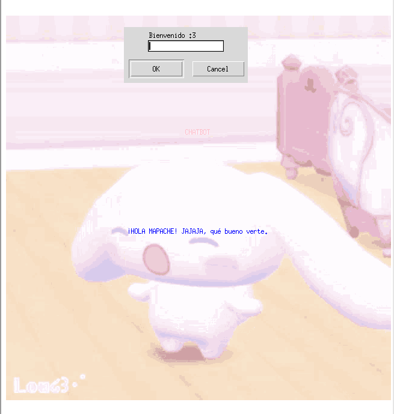
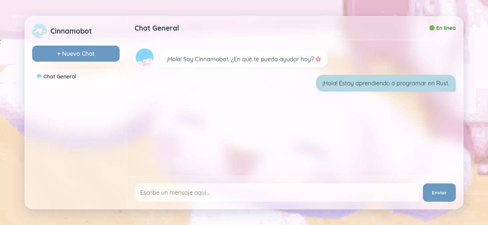

# Mi Chatbot Project 🐢

| Interfaz Gráfica (Turtle) | Interfaz Web (HTML/CSS) |
| :---: | :---: |
|  |  |

¡Hola! ¿Qué tal? Este es mi programa de un chatbot. Su nombre es cinnamonbot.

## 🚀 Cómo ejecutarlo (Quick Start)
¿Quieres probarlo tú mismo?
1. Clona el repositorio: `git clone https://github.com/N-near/Chatbot.git`
2. Instala las dependencias: `pip install -r requirements.txt`
3. Ejecuta la app: `python3 app.py` (o `python3 chatbot.py` para la versión de terminal).

## Cosas a aclarar

Este programa es una versión de prueba y aún tiene muchos errores. Simplemente quiero mostrar los avances que hago mientras aprendo a crear un chatbot desde cero.

### Errores conocidos

**1. Falsos positivos**

Por ejemplo, si le dices al chatbot *"Hey, no quiero que me des un chiste"*, te va a dar un chiste. Ya entenderás el punto al que voy.

**2. Problemas con los signos de puntuación**

Por ejemplo, si le preguntas *"¿Qué hora es?"* o *"Hola, ¿cómo estás?"*, el programa puede responder *"Desconocido"* porque todavía tiene problemas para manejar los signos de puntuación, entre otras cosas.

## 🚀 ¿Por qué publico el proyecto ahora?

El objetivo es mostrar mi programa. Puede ser malo, pero ten en cuenta que es una versión de prueba.

La idea es mejorarlo día a día e ir guardando los avances en el repositorio para ver cuánto he aprendido, avanzado y mejorado.

## 🧠 ¿Qué he aprendido?

- Aprendí a usar funciones nuevas.
- Aprendí a simplificar mi código para que no fuera una escalera de `if/elif`.
- Mejoré mucho mi lógica al cuestionarme por qué algo no funciona o por qué funciona de cierta manera.

### 🤖 ¿Usé inteligencia artificial?

Sí, pero no con un simple *"Hey, dame el código"* o *"Solucióname esto"*, sino como un tutor.

Cuando me quedaba atrapado en un problema, me ayudaba a entenderlo en lugar de tener que decir *"¿Qué demonios hago?"* y buscar durante diez horas en la documentación y Google sin saber por dónde empezar.

Eso sí, no me gusta usar las IA para que literalmente te hagan todo el código, pues, en mi opinión, no aprendes nada nuevo de esa manera. Además, a veces pueden darte resultados que no te gusten.

## 🤪 Confesiones de un desarrollador

Para ser totalmente honesto, tengo que confesar algo: *Este proyecto me cambió la vida. No sé si para bien o para mal, pero definitivamente me cambió la vida.* 

3 horas después: *"Oye Codex, mejor hazme el programa entero *tipitupi*"*... Por favor, deja de chuparme los tokens, te lo ruego. 😂

*(Es broma, prometo que no soy el peor vibecoder... ¿o sí?)*

## 🔧 Próximos planes

Mientras sigo mejorando mi código, estos son mis planes:

- Mejorar `intencion.py`.
- Mejorar `respuestas.py`.
- Agregar otro idioma, ya que actualmente solo está en español.
- Mejorar la documentación.
- Cambiar Turtle por HTML y, en un futuro, C++.

## ❤️ Gracias por leer

Si lees esto, ¡eres una cabra! 🐐 Confía en el proceso y en mi proceso.

Espero que tengas un bonito día y gracias por ver mi proyecto. Puedes opinar sobre él, decirme qué cosas puedo agregar o, si te interesa colaborar en algo, ¡hazlo! Estaré muy agradecido. :3

**¡GRACIAS POR LEER Y QUE TENGAS UN LINDO DÍA! :3**
